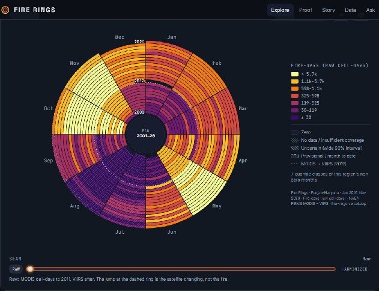
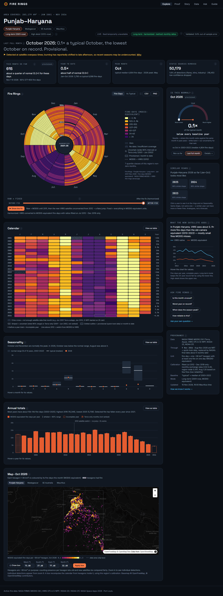
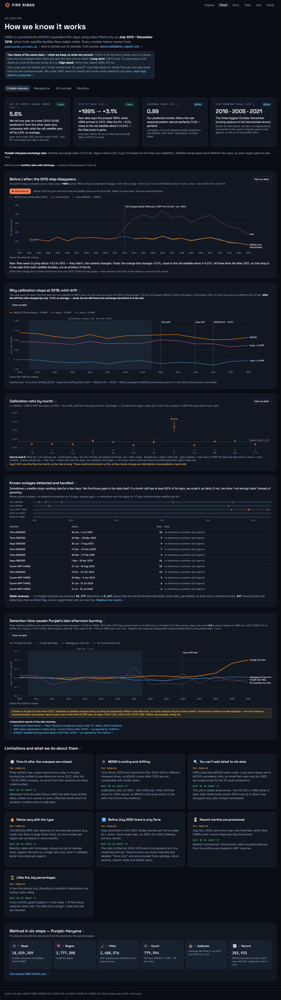

# Fire Rings

**25 years of fire, two generations of satellites, one honest record. Ask it anything.**

NASA Space Apps 2026 · Challenge: *Harmonization of MODIS and VIIRS Hot Spots* · Port Louis, Mauritius
Live: **https://fire-rings.vercel.app**



## What it does

MODIS (2000→, 1 km) and VIIRS (2012→, 375 m) see fire very differently. Joined naively, fire seems to explode in 2012
when VIIRS arrives. Fire Rings converts VIIRS into **MODIS-equivalent fire-days**, so every month since 2001 is measured with
the same ruler. It then answers one question for responders and land managers: **is this month normal?**

- **Fire Rings**: a radial calendar (years are rings, months are the clock) plus a grid calendar, with uncertainty hatching,
  provisional styling, keyboard navigation and a table view.
- **Seam slider**: morph the raw record into the harmonized one and watch the 2012 jump disappear.
- **Is this normal?**: a headline sentence, a percentile gauge with its uncertainty range, a 1-in-N-year return period, a
  low-activity guard, month-to-date comparison and similar years (analogues, not forecasts).
- **Month drill-down**: daily bars against the baseline band, every baseline value, a mini map and a CSV download.
- **Map**: MapLibre with region presets, rectangle drawing or a lat/lon box (recomputes the calendar for the box) and monthly hexagons.
- **Proof page**: before/after, orbit-drift evidence, out-of-sample validation, calibration ratios with intervals, and outages detected.
- **Open data**: harmonized CSV + Parquet, calibration and validation files, a static JSON API, and a citation (CC BY 4.0).
- **Ask Fire Rings**: a Gemini analyst that may only state numbers looked up from the record. Every answer shows the
  "numbers used", and a server-side check rejects any number not in the lookups.
- **Live layer**: the last 72 h of NOAA-20/21 near-real-time detections from NASA FIRMS (`/api/live`), filtered like the
  record, with a "LIVE · last satellite pass X h ago · N detections" badge and a separate provisional map layer. It is never
  mixed into the harmonized numbers.
- **Two views of the same data**: **Long-term** (2001–now, MODIS-equivalent, the fair 25-year comparison) and **High detail**
  (2012–now, native VIIRS 375 m, finer ~5 km² map hexagons). Everything on the page switches together (`?mode=detail`); CSV
  exports always carry both units. A "What the new satellite adds" card shows how many more fire-days VIIRS sees.
- **Guide** (`/guide`): every chart and number explained in plain words, with worked examples computed from the data,
  annotated real charts, a glossary and typo-tolerant search. Every chart title on the site has an ⓘ linking to its entry.
- **Globe time-lapse** with real fire hexagons, **stories** for all four regions (`/story`) and a **60-day NRT pull** of NOAA-20/21 for Punjab.
- **QA**: `docs/QA_WALKTHROUGH.md` (click-by-click test script with the expected value and JSON path for every element)
  and `npm run test:e2e` (keyboard/drawer/box/mode checks, a claims check comparing 131 on-screen numbers with the published
  JSON, every Ask chip × region × style through the saved-answer fallback, and the Guide/ⓘ coverage check).
  `docs/ask_quality.md`: 60 questions with expected numbers read from the JSON (60/60 on the last run).

| Region dashboard | Proof |
|---|---|
|  |  |

## Does it work? (out-of-sample, `docs/validation_report.md`)

| Region | Method | Annual error (leave-one-year-out) | Step at 2012: raw → harmonized (MODIS alone) | Verdict |
|---|---|---:|---|---|
| Punjab–Haryana | monthly ratios | 5.6 % | +199 % → +3.1 % (+4.2 %) | pass |
| Madagascar | monthly ratios | 2.8 % | +294 % → +2.9 % (+3.0 %) | pass |
| SE Australia | single ratio (fallback, validated better) | 9.2 % | +168 % → +9.2 % (+10.2 %) | pass; Black Summer 2019–20 ranks #1 |
| Mauritius | monthly ratios | 24.4 % | +405 % → +11.1 % (+5.9 %) | low-activity: reported, not judged |

Calibration uses **July 2012 – December 2019 only**: MODIS orbits drift after 2020 (Terra) and Dec 2021 (Aqua).

**Known limitation, measured:** Punjab's autumn stubble burning has shifted to late afternoon, after the ~13:30 overpasses.
In our data, daytime Aqua÷VIIRS (Aqua now passes later) rose ×1.46 in Punjab Oct–Nov for 2022–26 vs 2013–19, but stayed
flat in Punjab Apr–May (×0.95), Madagascar (×1.02) and SE Australia (×0.86) ([docs/punjab_timing.md](docs/punjab_timing.md)).
Recent Punjab seasons may be undercounted; the app shows this caveat and does not adjust the numbers.
Months before July 2002 (Terra only) are shown but not ranked; Madagascar's biggest seasons are 2016–17, 2019–20, 2007–08.

## How it works (short)

1. Unify 5 satellite streams from NASA FIRMS (archive + near-real-time) into one schema, using the local solar day.
2. Apply the same filters to both sensors: drop low-confidence detections; mask static sources (flares, kilns, industry) using FIRMS flags and persistence.
3. Count **fire cell-days** on an H3 res-6 grid (~36 km²), adjusting for satellite outages detected in the data.
4. Calibrate MODIS ÷ VIIRS per calendar month, shrunk toward the region-wide ratio (τ chosen by leave-one-year-out); bridge to Terra-only before July 2002 and to NOAA-20 after S-NPP.
5. Estimate uncertainty with a year-block bootstrap ×500 plus Poisson noise, and judge "normal" against a 2003–2022 baseline.
6. High detail: the same coverage-adjusted VIIRS cell-days *without* the conversion (H = k · V), judged against 2013–2022 (`pipeline/07b_detail.py`).

Full detail: **[METHODS.md](METHODS.md)**. Sources and libraries: **[DATA_SOURCES.md](DATA_SOURCES.md)**.

## Run it

```bash
# pipeline (Python 3.11): raw FIRMS CSVs in data/raw/{region}/{sensor}/ → web/public/data/v1/
python -m venv .venv && .venv\Scripts\activate
pip install -r pipeline/requirements.txt
python pipeline/01_fetch_nrt.py        # optional: live NOAA-20/21 NRT for Punjab (FIRMS_MAP_KEY in .env)
python pipeline/run_all.py             # a few minutes, then: pytest pipeline/tests

# web (Node 20)
cd web && npm install && npm run dev
npm run build && npm run test:e2e      # Playwright checks (starts vite preview itself)
npm run screens                        # screenshots of every page at 1440 px and 360 px → docs/screens/
# AI: GEMINI_API_KEY (+ optional GEMINI_MODEL) as Vercel env vars; scripts/ask_cache.ts precomputes offline answers
```

## Repository

`pipeline/` Python (DuckDB, Polars, H3, NumPy/SciPy) · `web/` Vite + React + TypeScript + Tailwind, D3, MapLibre ·
`web/api/` Vercel functions (Gemini) · `docs/` inventory, mask check, pipeline report, validation report, S-NPP end check, AI eval, screenshots.

## Licences and credits

Code: MIT ([LICENSE](LICENSE)). Harmonized data: CC BY 4.0, please cite ([CITATION.cff](CITATION.cff)).
We acknowledge the use of data from NASA's Fire Information for Resource Management System (FIRMS), part of NASA's ESDIS.
Basemap © OpenFreeMap, © OpenStreetMap contributors.

**AI disclosure.** Built with Claude Code (Anthropic) as a coding assistant. The in-app analyst uses Google Gemini, grounded
only in this project's published data.
