# QA walkthrough — Fire Rings

Generated by `node web/scripts/qa_doc.mjs` from the published data (data through **2026-11-09**, generated 2026-11-09T18:12Z).
Every expected value below is read from `web/public/data/v1/…` at generation time; rerun the script after any data change.
Automated twin: `cd web && npm run test:e2e` (keyboard/drawer/box checks + `claims_check.mjs`, which compares every headline, KPI, gauge,
validation card, globe-panel and timing-card number on screen against this same JSON).

Test on: desktop 1440 px and phone 390 px (Chrome device toolbar), live site https://fire-rings.vercel.app. Allow ~3 s for maps.

**Paths:** `regions/{id}.json` means `web/public/data/v1/regions/{id}.json`; `validation_v1.json` means `web/public/data/v1/dataset/validation_v1.json`.

## 0. Every page — header and footer

| # | On-screen label | Where | Do | Should happen | Why it exists | Verify it is real (file → key = current value) |
|---:|---|---|---|---|---|---|
| 1 | FIRE RINGS (logo) | top-left | click | goes to `/` | navigation | — |
| 2 | Explore · Proof · Story · Data · Ask | top-right nav | click each; also Tab through | route changes; active item highlighted; visible orange focus ring | Quality bar (master plan §10): accessible to keyboard and screen-reader users | — |
| 3 | Skip to content | appears top-left on first Tab | press Tab once, then Enter | focus jumps to the main content | Quality bar (master plan §10): accessible to keyboard and screen-reader users | — |
| 4 | Active-fire data: NASA FIRMS (…) | footer | read | credits FIRMS + sensors | Space Apps rule: cite data | `DATA_SOURCES.md` |

## 1. Landing `/`

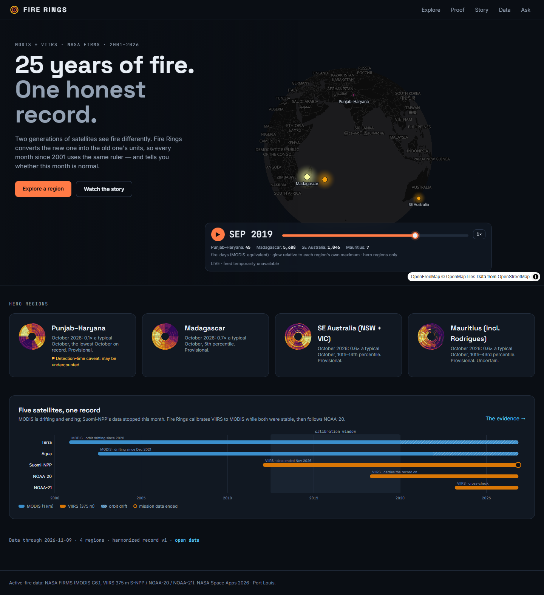

| # | On-screen label | Where | Do | Should happen | Why it exists | Verify it is real (file → key = current value) |
|---:|---|---|---|---|---|---|
| 1 | 25 years of fire. One honest record. | hero, left | read | tagline + two buttons | pitch | — |
| 2 | Explore a region | hero button | click | opens `/r/punjab` | navigation | — |
| 3 | Watch the story | hero button | click | opens `/story/madagascar` | Local Impact: Indian Ocean / Madagascar / Mauritius | — |
| 4 | Globe (right) | hero background | wait 3 s; drag to rotate | dark globe; 4 glowing markers on Punjab, Madagascar, SE Australia and the main island of Mauritius (not in the ocean); slow auto-rotation stops when you drag | Wow: global context | `regions/{id}.json → geo.anchor` (Mauritius = [57.5814,-20.1874]) |
| 5 | ▶ / ❚❚ and SEP 2019 | panel at bottom of globe | press ▶ | month counter plays 2001→2026, markers brighten/dim; slider follows; press again to pause | Challenge core: harmonize MODIS and VIIRS into one consistent record | frame values: `regions/{id}.json → months[y,m].H` |
| 6 | Punjab–Haryana: N · Madagascar: N … | panel, second line | pause on SEP 2019 | shows Punjab–Haryana: 45 and Madagascar: 5,688 | Challenge core: harmonize MODIS and VIIRS into one consistent record | `regions/punjab.json → months[2019-09].H` = 45 |
| 7 | 1× / 4× | panel, right | click | playback speed toggles | usability | — |
| 8 | LIVE · last satellite pass … · detections in 72 h | panel, third line | wait a few seconds | shows per-region counts from NASA FIRMS (or "feed temporarily unavailable" — never a spinner) | Wow: live NRT; never mixed into the record | `GET /api/live?region=punjab → count, last_acq_utc` |
| 9 | Hero regions (4 cards with mini rings) | below hero | click a card | opens that region; each card shows its last-full-month headline | Challenge: "is this month normal?" for users; Best Use of Data (accessible) | `regions/{id}.json → latest_complete` |
| 10 | Five satellites, one record | card below | read | bars for Terra, Aqua, S-NPP, NOAA-20, NOAA-21; hatched drift; calibration window band | Best Use of Science: validated out of sample, honest limits | `docs/data_inventory.md` |

## 2.1 Region `/r/punjab` — Punjab–Haryana

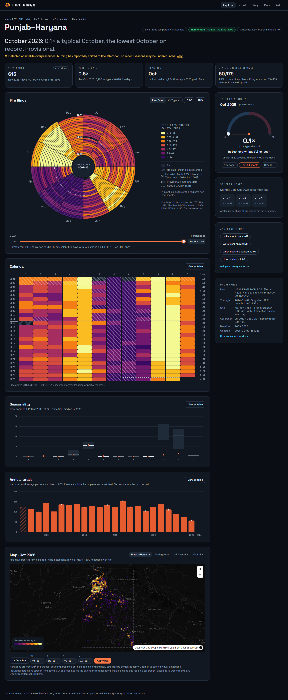

| # | On-screen label | Where | Do | Should happen | Why it exists | Verify it is real (file → key = current value) |
|---:|---|---|---|---|---|---|
| 1 | Header line (area · Jan 2001 – …) | top | read | "203,179 km² clip box area" | provenance | `regions/punjab.json → area_km2, area_note` |
| 2 | LIVE · Last satellite pass X h ago · N detections in 72 h | top-right badge | wait ≤ 10 s | live count, or "feed temporarily unavailable" | Wow: near-real-time; provisional | `GET /api/live?region=punjab` |
| 3 | Harmonized · method: … | top-right badge | read | "monthly ratios" | Best Use of Science: validated out of sample, honest limits | `validation_v1.json → regions.punjab.summary.method` = monthly |
| 4 | Validated: … | top-right badge | click | "5.6% out-of-sample error"; opens /proof | Best Use of Science: validated out of sample, honest limits | `regions/punjab.json → validation.loyo_err_pct` = 5.6 |
| 5 | Headline sentence | large text under the title | read | starts "October 2026:" then "0.1× a typical October" + "Provisional." + the detection-time caveat | Challenge: "is this month normal?" for users; Best Use of Data (accessible) | `regions/punjab.json → latest_complete` + `months[2026-10].ratio` = 0.08 |
| 6 | THIS MONTH | KPI card 1 | read | 615; "Nov 2026 · days 1–9 · 90% 577–654 fire-days"; badge "provisional" | Challenge: "is this month normal?" for users; Best Use of Data (accessible) | `latest.value/lo/hi` = 614.9 / 577.3 / 654.4 |
| 7 | YEAR TO DATE | KPI card 2 | read | 0.5×; "Jan–Oct 2026: 3,795 vs typical 8,098 fire-days" | Challenge: "is this month normal?" for users; Best Use of Data (accessible) | sum of `months[2026].H` ÷ sum of `climatology.median` |
| 8 | PEAK MONTH | KPI card 3 | read | Oct; "typical median 4,904 fire-days" | Challenge: show the record as a calendar | `climatology.median[9]` = 4903.7 |
| 9 | STATIC SOURCES REMOVED | KPI card 4 | read | 50,179 | Best Use of Science: validated out of sample, honest limits | `quality.masked_static_total` = 50179; `docs/mask_check.md` |
| 10 | Fire Rings (radial chart) | big card | hover a cell; then Tab into the chart and use ←→↑↓, Enter, Esc | rings draw in from the centre; hovered month + its spoke and ring stay bright; tooltip with value, 90% interval, ratio, source, raw hotspots, flags; Enter opens the month drawer | Challenge: show the record as a calendar; Quality bar (master plan §10): accessible to keyboard and screen-reader users | e.g. Nov 2019 tooltip "3,077" = `months[2019-11].H` = 3076.8 |
| 11 | Fire-days / vs typical | top-right of the rings card | click "vs typical" | colours switch to blue (below typical) ↔ red (above); ▲▼ in the grid; legend "Ratio to typical month" | Challenge: "is this month normal?" for users; Best Use of Data (accessible) | `months[].H ÷ climatology.median` |
| 12 | CSV | rings card | click | downloads fire-rings_punjab.csv; first line "# Fire Rings v1 · …citation"; opens in Excel | Challenge: export CSV; Best Use of Data (give data back) | columns = `months[]` fields |
| 13 | PNG | rings card | click | downloads a PNG of the rings with legend and caption | Challenge: export CSV; Best Use of Data (give data back) | — |
| 14 | SEAM · RAW ●──○ HARMONIZED | under the rings | drag left to RAW, then back | at RAW the 2012 ring jumps bright (VIIRS sees more); at HARMONIZED it is smooth; colours morph continuously | Challenge core: harmonize MODIS and VIIRS into one consistent record (the key demo) | `validation.step_raw_pct` = +199.4% vs `step_harm_pct` = 3.1% |
| 15 | Calendar (grid) + View as table | card below | hover cells; click "View as table" | linked highlight with the rings; table of every month with values; "~" marks incomplete years; hatched = uncertain or Terra-only (2001 – Jun 2002) | Challenge: show the record as a calendar; Quality bar (master plan §10): accessible to keyboard and screen-reader users | `months[]` |
| 16 | Seasonality | chart card | hover a month; View as table | grey P10–P90 band, white median tick, orange dots for the selected year | Challenge: "is this month normal?" for users; Best Use of Data (accessible) | `climatology.p10/median/p90` |
| 17 | Annual totals | chart card | hover; View as table | bars with 90% whiskers; hollow = incomplete year; hatched = Terra-only months (2001, 2002, not ranked); no overlapping year labels | Best Use of Science: validated out of sample, honest limits | `annual[]` (2001/2002 `rankable: false`) |
| 18 | Map · MON YYYY | map card | wait; zoom in; click a preset; "▭ Draw box" then drag; or type W/S/E/N and "Apply box"; toggle "Live 72 h (provisional)" | soft hexagons over a dark basemap; place names readable; MODIS ● / VIIRS ▲ points appear from zoom 9 for the latest months; box → banner "Box view: …" and the calendar recomputes; live points are cyan rings | Challenge core: harmonize MODIS and VIIRS into one consistent record (any area) | `hexes/punjab/{year}.json`; view = `geo.view_bbox` [73.8,27.6,77.6,32.6] |
| 19 | Line under the map | map card | read | "Hexagons are ~36 km² on purpose: counting presence per hexagon lets old and new satellites be compared fairly. Zoom in to see individual detections." | explains the unit | METHODS.md §4 |
| 20 | IS THIS NORMAL? | right panel (below charts on mobile) | read; click "Nov so far" / "Last full month" / "Details →" | Oct 2026: gauge 0.1×, "below every baseline year", "median 4,904 fire-days" | Challenge: "is this month normal?" for users; Best Use of Data (accessible) | `months[2026-10].ratio, pct` = 0.08, [0,0] |
| 21 | SIMILAR YEARS | right panel | click a year | years 2025, 2024, 2023 with r values; "Analogues … not a forecast" | Challenge: "is this month normal?" for users; Best Use of Data (accessible) | `similar_detail.years` |
| 22 | ASK FIRE RINGS chips | right panel | click "Is this month unusual?" | drawer opens and answers within ~25 s; "Numbers used" expands; if the AI is unavailable a saved answer or "AI temporarily unavailable" appears | Best Use of Data (accessible): plain-English answers grounded in the data | `ask_cache.json → entries["punjab|Is this month unusual?"]` |
| 23 | PROVENANCE | right panel | read | sources, data end, unit, calibration window + ratios, baseline, updated time | Best Use of Science: validated out of sample, honest limits | `data_end` = 2026-11-09 |
| 24 | Month drawer (click any cell) | opens from the right | click Nov 2019; Esc to close | headline for that month; daily bars vs baseline band; dot plot of every baseline November; "Where" mini map; "Download daily CSV"; hotspot CSV for the latest months only | Challenge: "is this month normal?" for users; Best Use of Data (accessible); Challenge: export CSV; Best Use of Data (give data back) | `daily/punjab.json → "2019-11"` |

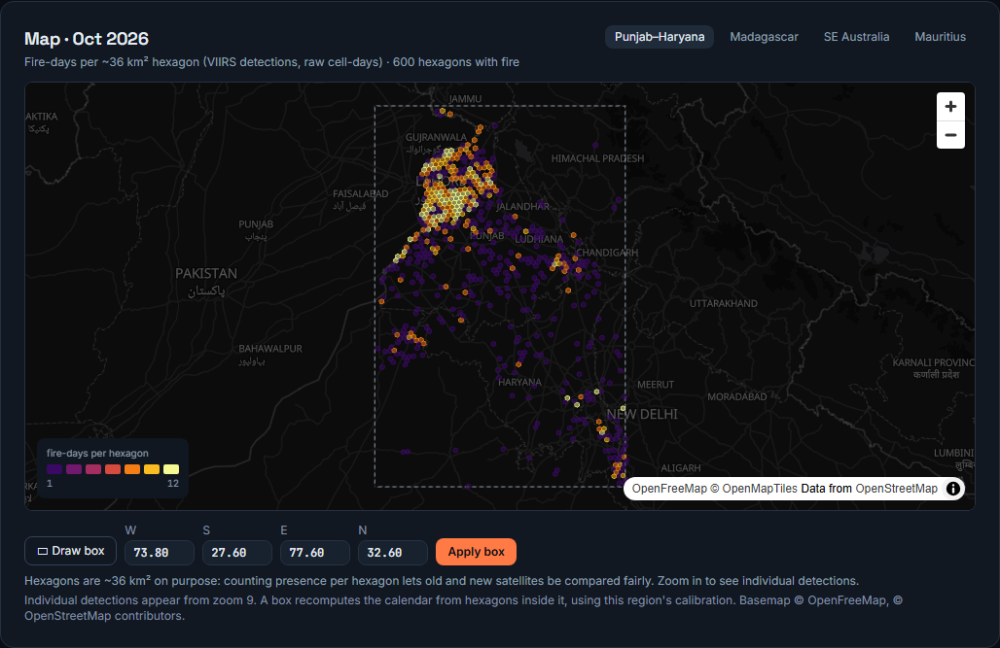

## 2.2 Region `/r/madagascar` — Madagascar

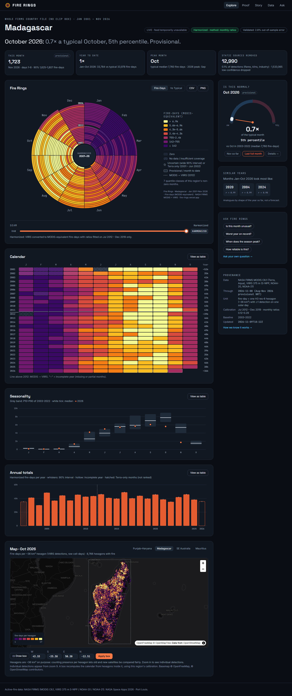

| # | On-screen label | Where | Do | Should happen | Why it exists | Verify it is real (file → key = current value) |
|---:|---|---|---|---|---|---|
| 1 | Header line (area · Jan 2001 – …) | top | read | "whole FIRMS country file (no clip box)" | provenance | `regions/madagascar.json → area_km2, area_note` |
| 2 | LIVE · Last satellite pass X h ago · N detections in 72 h | top-right badge | wait ≤ 10 s | live count, or "feed temporarily unavailable" | Wow: near-real-time; provisional | `GET /api/live?region=madagascar` |
| 3 | Harmonized · method: … | top-right badge | read | "monthly ratios" | Best Use of Science: validated out of sample, honest limits | `validation_v1.json → regions.madagascar.summary.method` = monthly |
| 4 | Validated: … | top-right badge | click | "2.8% out-of-sample error"; opens /proof | Best Use of Science: validated out of sample, honest limits | `regions/madagascar.json → validation.loyo_err_pct` = 2.8 |
| 5 | Headline sentence | large text under the title | read | starts "October 2026:" then "0.7× a typical October" + "Provisional." | Challenge: "is this month normal?" for users; Best Use of Data (accessible) | `regions/madagascar.json → latest_complete` + `months[2026-10].ratio` = 0.72 |
| 6 | THIS MONTH | KPI card 1 | read | 1,723; "Nov 2026 · days 1–8 · 90% 1,625–1,807 fire-days"; badge "provisional" | Challenge: "is this month normal?" for users; Best Use of Data (accessible) | `latest.value/lo/hi` = 1723 / 1624.9 / 1807 |
| 7 | YEAR TO DATE | KPI card 2 | read | 1×; "Jan–Oct 2026: 33,784 vs typical 33,978 fire-days" | Challenge: "is this month normal?" for users; Best Use of Data (accessible) | sum of `months[2026].H` ÷ sum of `climatology.median` |
| 8 | PEAK MONTH | KPI card 3 | read | Oct; "typical median 7,760 fire-days" | Challenge: show the record as a calendar | `climatology.median[9]` = 7759.9 |
| 9 | STATIC SOURCES REMOVED | KPI card 4 | read | 12,990 | Best Use of Science: validated out of sample, honest limits | `quality.masked_static_total` = 12990; `docs/mask_check.md` |
| 10 | Fire Rings (radial chart) | big card | hover a cell; then Tab into the chart and use ←→↑↓, Enter, Esc | rings draw in from the centre; hovered month + its spoke and ring stay bright; tooltip with value, 90% interval, ratio, source, raw hotspots, flags; Enter opens the month drawer | Challenge: show the record as a calendar; Quality bar (master plan §10): accessible to keyboard and screen-reader users | e.g. Nov 2019 tooltip "4,080" = `months[2019-11].H` = 4079.9 |
| 11 | Fire-days / vs typical | top-right of the rings card | click "vs typical" | colours switch to blue (below typical) ↔ red (above); ▲▼ in the grid; legend "Ratio to typical month" | Challenge: "is this month normal?" for users; Best Use of Data (accessible) | `months[].H ÷ climatology.median` |
| 12 | CSV | rings card | click | downloads fire-rings_madagascar.csv; first line "# Fire Rings v1 · …citation"; opens in Excel | Challenge: export CSV; Best Use of Data (give data back) | columns = `months[]` fields |
| 13 | PNG | rings card | click | downloads a PNG of the rings with legend and caption | Challenge: export CSV; Best Use of Data (give data back) | — |
| 14 | SEAM · RAW ●──○ HARMONIZED | under the rings | drag left to RAW, then back | at RAW the 2012 ring jumps bright (VIIRS sees more); at HARMONIZED it is smooth; colours morph continuously | Challenge core: harmonize MODIS and VIIRS into one consistent record (the key demo) | `validation.step_raw_pct` = +293.6% vs `step_harm_pct` = 2.9% |
| 15 | Calendar (grid) + View as table | card below | hover cells; click "View as table" | linked highlight with the rings; table of every month with values; "~" marks incomplete years; hatched = uncertain or Terra-only (2001 – Jun 2002) | Challenge: show the record as a calendar; Quality bar (master plan §10): accessible to keyboard and screen-reader users | `months[]` |
| 16 | Seasonality | chart card | hover a month; View as table | grey P10–P90 band, white median tick, orange dots for the selected year | Challenge: "is this month normal?" for users; Best Use of Data (accessible) | `climatology.p10/median/p90` |
| 17 | Annual totals | chart card | hover; View as table | bars with 90% whiskers; hollow = incomplete year; hatched = Terra-only months (2001, 2002, not ranked); no overlapping year labels | Best Use of Science: validated out of sample, honest limits | `annual[]` (2001/2002 `rankable: false`) |
| 18 | Map · MON YYYY | map card | wait; zoom in; click a preset; "▭ Draw box" then drag; or type W/S/E/N and "Apply box"; toggle "Live 72 h (provisional)" | soft hexagons over a dark basemap; place names readable; MODIS ● / VIIRS ▲ points appear from zoom 9 for the latest months; box → banner "Box view: …" and the calendar recomputes; live points are cyan rings | Challenge core: harmonize MODIS and VIIRS into one consistent record (any area) | `hexes/madagascar/{year}.json`; view = `geo.view_bbox` [43.326,-25.375,50.197,-12.507] |
| 19 | Line under the map | map card | read | "Hexagons are ~36 km² on purpose: counting presence per hexagon lets old and new satellites be compared fairly. Zoom in to see individual detections." | explains the unit | METHODS.md §4 |
| 20 | IS THIS NORMAL? | right panel (below charts on mobile) | read; click "Nov so far" / "Last full month" / "Details →" | Oct 2026: gauge 0.7×, "5th percentile", "median 7,760 fire-days" | Challenge: "is this month normal?" for users; Best Use of Data (accessible) | `months[2026-10].ratio, pct` = 0.72, [5,5] |
| 21 | SIMILAR YEARS | right panel | click a year | years 2020, 2004, 2024 with r values; "Analogues … not a forecast" | Challenge: "is this month normal?" for users; Best Use of Data (accessible) | `similar_detail.years` |
| 22 | ASK FIRE RINGS chips | right panel | click "Is this month unusual?" | drawer opens and answers within ~25 s; "Numbers used" expands; if the AI is unavailable a saved answer or "AI temporarily unavailable" appears | Best Use of Data (accessible): plain-English answers grounded in the data | `ask_cache.json → entries["madagascar|Is this month unusual?"]` |
| 23 | PROVENANCE | right panel | read | sources, data end, unit, calibration window + ratios, baseline, updated time | Best Use of Science: validated out of sample, honest limits | `data_end` = 2026-11-08 |
| 24 | Month drawer (click any cell) | opens from the right | click Nov 2019; Esc to close | headline for that month; daily bars vs baseline band; dot plot of every baseline November; "Where" mini map; "Download daily CSV"; hotspot CSV for the latest months only | Challenge: "is this month normal?" for users; Best Use of Data (accessible); Challenge: export CSV; Best Use of Data (give data back) | `daily/madagascar.json → "2019-11"` |

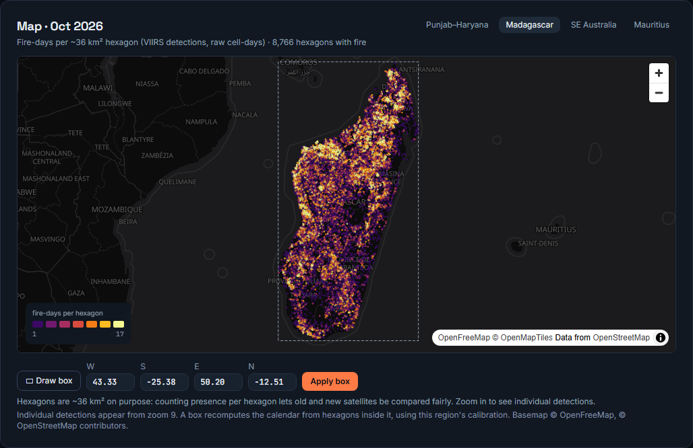

## 2.3 Region `/r/se_australia` — SE Australia (NSW + VIC)

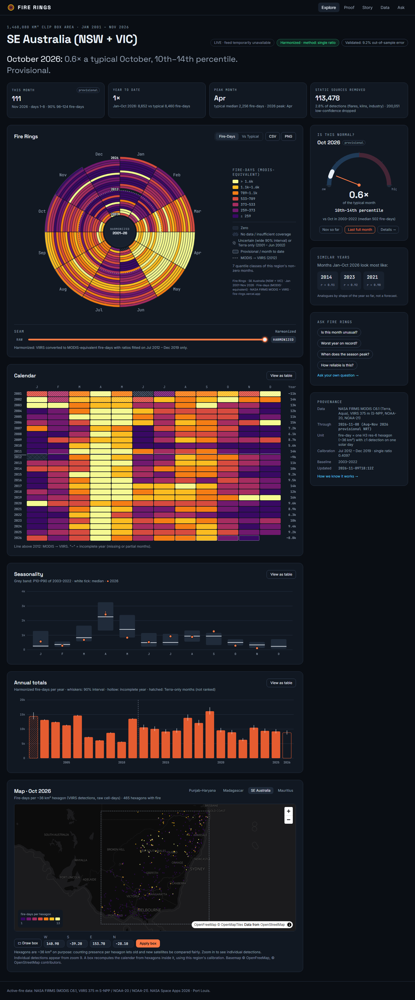

| # | On-screen label | Where | Do | Should happen | Why it exists | Verify it is real (file → key = current value) |
|---:|---|---|---|---|---|---|
| 1 | Header line (area · Jan 2001 – …) | top | read | "1,460,080 km² clip box area" | provenance | `regions/se_australia.json → area_km2, area_note` |
| 2 | LIVE · Last satellite pass X h ago · N detections in 72 h | top-right badge | wait ≤ 10 s | live count, or "feed temporarily unavailable" | Wow: near-real-time; provisional | `GET /api/live?region=se_australia` |
| 3 | Harmonized · method: … | top-right badge | read | "single ratio" | Best Use of Science: validated out of sample, honest limits | `validation_v1.json → regions.se_australia.summary.method` = pooled |
| 4 | Validated: … | top-right badge | click | "9.2% out-of-sample error"; opens /proof | Best Use of Science: validated out of sample, honest limits | `regions/se_australia.json → validation.loyo_err_pct` = 9.2 |
| 5 | Headline sentence | large text under the title | read | starts "October 2026:" then "0.6× a typical October" + "Provisional." | Challenge: "is this month normal?" for users; Best Use of Data (accessible) | `regions/se_australia.json → latest_complete` + `months[2026-10].ratio` = 0.57 |
| 6 | THIS MONTH | KPI card 1 | read | 111; "Nov 2026 · days 1–8 · 90% 96–124 fire-days"; badge "provisional" | Challenge: "is this month normal?" for users; Best Use of Data (accessible) | `latest.value/lo/hi` = 110.5 / 96.2 / 124.4 |
| 7 | YEAR TO DATE | KPI card 2 | read | 1×; "Jan–Oct 2026: 8,652 vs typical 8,460 fire-days" | Challenge: "is this month normal?" for users; Best Use of Data (accessible) | sum of `months[2026].H` ÷ sum of `climatology.median` |
| 8 | PEAK MONTH | KPI card 3 | read | Apr; "typical median 2,256 fire-days" | Challenge: show the record as a calendar | `climatology.median[3]` = 2256.2 |
| 9 | STATIC SOURCES REMOVED | KPI card 4 | read | 113,478 | Best Use of Science: validated out of sample, honest limits | `quality.masked_static_total` = 113478; `docs/mask_check.md` |
| 10 | Fire Rings (radial chart) | big card | hover a cell; then Tab into the chart and use ←→↑↓, Enter, Esc | rings draw in from the centre; hovered month + its spoke and ring stay bright; tooltip with value, 90% interval, ratio, source, raw hotspots, flags; Enter opens the month drawer | Challenge: show the record as a calendar; Quality bar (master plan §10): accessible to keyboard and screen-reader users | e.g. Nov 2019 tooltip "2,441" = `months[2019-11].H` = 2440.8 |
| 11 | Fire-days / vs typical | top-right of the rings card | click "vs typical" | colours switch to blue (below typical) ↔ red (above); ▲▼ in the grid; legend "Ratio to typical month" | Challenge: "is this month normal?" for users; Best Use of Data (accessible) | `months[].H ÷ climatology.median` |
| 12 | CSV | rings card | click | downloads fire-rings_se_australia.csv; first line "# Fire Rings v1 · …citation"; opens in Excel | Challenge: export CSV; Best Use of Data (give data back) | columns = `months[]` fields |
| 13 | PNG | rings card | click | downloads a PNG of the rings with legend and caption | Challenge: export CSV; Best Use of Data (give data back) | — |
| 14 | SEAM · RAW ●──○ HARMONIZED | under the rings | drag left to RAW, then back | at RAW the 2012 ring jumps bright (VIIRS sees more); at HARMONIZED it is smooth; colours morph continuously | Challenge core: harmonize MODIS and VIIRS into one consistent record (the key demo) | `validation.step_raw_pct` = +167.6% vs `step_harm_pct` = 9.2% |
| 15 | Calendar (grid) + View as table | card below | hover cells; click "View as table" | linked highlight with the rings; table of every month with values; "~" marks incomplete years; hatched = uncertain or Terra-only (2001 – Jun 2002) | Challenge: show the record as a calendar; Quality bar (master plan §10): accessible to keyboard and screen-reader users | `months[]` |
| 16 | Seasonality | chart card | hover a month; View as table | grey P10–P90 band, white median tick, orange dots for the selected year | Challenge: "is this month normal?" for users; Best Use of Data (accessible) | `climatology.p10/median/p90` |
| 17 | Annual totals | chart card | hover; View as table | bars with 90% whiskers; hollow = incomplete year; hatched = Terra-only months (2001, 2002, not ranked); no overlapping year labels | Best Use of Science: validated out of sample, honest limits | `annual[]` (2001/2002 `rankable: false`) |
| 18 | Map · MON YYYY | map card | wait; zoom in; click a preset; "▭ Draw box" then drag; or type W/S/E/N and "Apply box"; toggle "Live 72 h (provisional)" | soft hexagons over a dark basemap; place names readable; MODIS ● / VIIRS ▲ points appear from zoom 9 for the latest months; box → banner "Box view: …" and the calendar recomputes; live points are cyan rings | Challenge core: harmonize MODIS and VIIRS into one consistent record (any area) | `hexes/se_australia/{year}.json`; view = `geo.view_bbox` [140.9,-39.2,153.7,-28.1] |
| 19 | Line under the map | map card | read | "Hexagons are ~36 km² on purpose: counting presence per hexagon lets old and new satellites be compared fairly. Zoom in to see individual detections." | explains the unit | METHODS.md §4 |
| 20 | IS THIS NORMAL? | right panel (below charts on mobile) | read; click "Nov so far" / "Last full month" / "Details →" | Oct 2026: gauge 0.6×, "10th–14th percentile", "median 502 fire-days" | Challenge: "is this month normal?" for users; Best Use of Data (accessible) | `months[2026-10].ratio, pct` = 0.57, [10,14] |
| 21 | SIMILAR YEARS | right panel | click a year | years 2014, 2023, 2021 with r values; "Analogues … not a forecast" | Challenge: "is this month normal?" for users; Best Use of Data (accessible) | `similar_detail.years` |
| 22 | ASK FIRE RINGS chips | right panel | click "Is this month unusual?" | drawer opens and answers within ~25 s; "Numbers used" expands; if the AI is unavailable a saved answer or "AI temporarily unavailable" appears | Best Use of Data (accessible): plain-English answers grounded in the data | `ask_cache.json → entries["se_australia|Is this month unusual?"]` |
| 23 | PROVENANCE | right panel | read | sources, data end, unit, calibration window + ratios, baseline, updated time | Best Use of Science: validated out of sample, honest limits | `data_end` = 2026-11-08 |
| 24 | Month drawer (click any cell) | opens from the right | click Nov 2019; Esc to close | headline for that month; daily bars vs baseline band; dot plot of every baseline November; "Where" mini map; "Download daily CSV"; hotspot CSV for the latest months only | Challenge: "is this month normal?" for users; Best Use of Data (accessible); Challenge: export CSV; Best Use of Data (give data back) | `daily/se_australia.json → "2019-11"` |

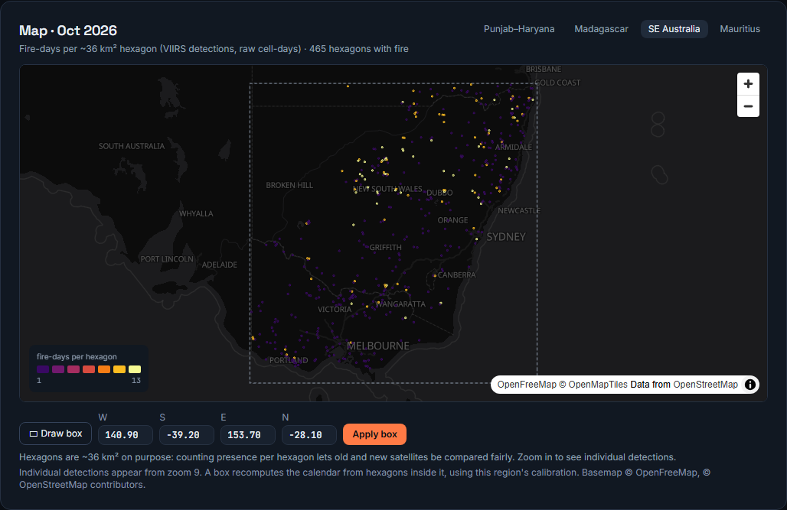

## 2.4 Region `/r/mauritius` — Mauritius (incl. Rodrigues)

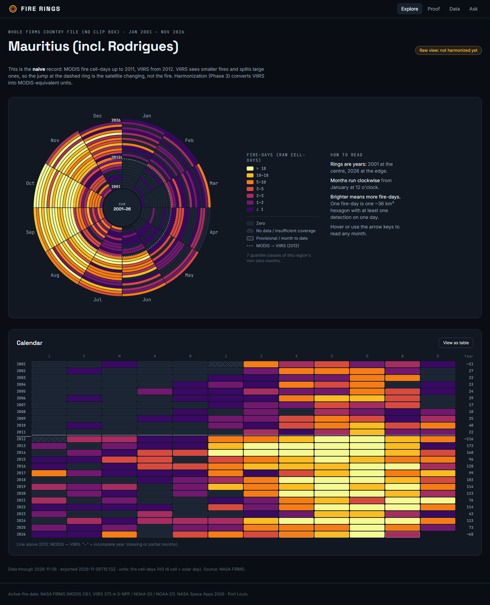

| # | On-screen label | Where | Do | Should happen | Why it exists | Verify it is real (file → key = current value) |
|---:|---|---|---|---|---|---|
| 1 | Header line (area · Jan 2001 – …) | top | read | "whole FIRMS country file (no clip box)" | provenance | `regions/mauritius.json → area_km2, area_note` |
| 2 | LIVE · Last satellite pass X h ago · N detections in 72 h | top-right badge | wait ≤ 10 s | live count, or "feed temporarily unavailable" | Wow: near-real-time; provisional | `GET /api/live?region=mauritius` |
| 3 | Harmonized · method: … | top-right badge | read | "monthly ratios" | Best Use of Science: validated out of sample, honest limits | `validation_v1.json → regions.mauritius.summary.method` = monthly |
| 4 | Validated: … | top-right badge | click | "low-activity region"; opens /proof | Best Use of Science: validated out of sample, honest limits | `regions/mauritius.json → validation.loyo_err_pct` = 24.4 |
| 5 | Headline sentence | large text under the title | read | starts "October 2026:" then "0.6× a typical October" + "Provisional." | Challenge: "is this month normal?" for users; Best Use of Data (accessible) | `regions/mauritius.json → latest_complete` + `months[2026-10].ratio` = 0.59 |
| 6 | THIS MONTH | KPI card 1 | read | 1; "Nov 2026 · days 1–8 · 90% 0–1 fire-days"; badge "provisional" | Challenge: "is this month normal?" for users; Best Use of Data (accessible) | `latest.value/lo/hi` = 0.5 / 0.1 / 1 |
| 7 | YEAR TO DATE | KPI card 2 | read | 0.8×; "Jan–Oct 2026: 15 vs typical 19 fire-days" | Challenge: "is this month normal?" for users; Best Use of Data (accessible) | sum of `months[2026].H` ÷ sum of `climatology.median` |
| 8 | PEAK MONTH | KPI card 3 | read | Oct; "typical median 7 fire-days" | Challenge: show the record as a calendar | `climatology.median[9]` = 6.7 |
| 9 | STATIC SOURCES REMOVED | KPI card 4 | read | 428 | Best Use of Science: validated out of sample, honest limits | `quality.masked_static_total` = 428; `docs/mask_check.md` |
| 10 | Fire Rings (radial chart) | big card | hover a cell; then Tab into the chart and use ←→↑↓, Enter, Esc | rings draw in from the centre; hovered month + its spoke and ring stay bright; tooltip with value, 90% interval, ratio, source, raw hotspots, flags; Enter opens the month drawer | Challenge: show the record as a calendar; Quality bar (master plan §10): accessible to keyboard and screen-reader users | e.g. Nov 2019 tooltip "4" = `months[2019-11].H` = 4 |
| 11 | Fire-days / vs typical | top-right of the rings card | click "vs typical" | colours switch to blue (below typical) ↔ red (above); ▲▼ in the grid; legend "Ratio to typical month" | Challenge: "is this month normal?" for users; Best Use of Data (accessible) | `months[].H ÷ climatology.median` |
| 12 | CSV | rings card | click | downloads fire-rings_mauritius.csv; first line "# Fire Rings v1 · …citation"; opens in Excel | Challenge: export CSV; Best Use of Data (give data back) | columns = `months[]` fields |
| 13 | PNG | rings card | click | downloads a PNG of the rings with legend and caption | Challenge: export CSV; Best Use of Data (give data back) | — |
| 14 | SEAM · RAW ●──○ HARMONIZED | under the rings | drag left to RAW, then back | at RAW the 2012 ring jumps bright (VIIRS sees more); at HARMONIZED it is smooth; colours morph continuously | Challenge core: harmonize MODIS and VIIRS into one consistent record (the key demo) | `validation.step_raw_pct` = +405.2% vs `step_harm_pct` = 11.1% |
| 15 | Calendar (grid) + View as table | card below | hover cells; click "View as table" | linked highlight with the rings; table of every month with values; "~" marks incomplete years; hatched = uncertain or Terra-only (2001 – Jun 2002) | Challenge: show the record as a calendar; Quality bar (master plan §10): accessible to keyboard and screen-reader users | `months[]` |
| 16 | Seasonality | chart card | hover a month; View as table | grey P10–P90 band, white median tick, orange dots for the selected year | Challenge: "is this month normal?" for users; Best Use of Data (accessible) | `climatology.p10/median/p90` |
| 17 | Annual totals | chart card | hover; View as table | bars with 90% whiskers; hollow = incomplete year; hatched = Terra-only months (2001, 2002, not ranked); no overlapping year labels | Best Use of Science: validated out of sample, honest limits | `annual[]` (2001/2002 `rankable: false`) |
| 18 | Map · MON YYYY | map card | wait; zoom in; click a preset; "▭ Draw box" then drag; or type W/S/E/N and "Apply box"; toggle "Live 72 h (provisional)" | soft hexagons over a dark basemap; place names readable; MODIS ● / VIIRS ▲ detection points shown at any zoom; "Rodrigues →" button flies to Rodrigues; box → banner "Box view: …" and the calendar recomputes; live points are cyan rings | Challenge core: harmonize MODIS and VIIRS into one consistent record (any area) | `hexes/mauritius/{year}.json`; view = `geo.view_bbox` [57.364,-20.537,57.814,-19.961] |
| 19 | Line under the map | map card | read | "Hexagons are ~36 km² on purpose: counting presence per hexagon lets old and new satellites be compared fairly. Zoom in to see individual detections." | explains the unit | METHODS.md §4 |
| 20 | IS THIS NORMAL? | right panel (below charts on mobile) | read; click "Nov so far" / "Last full month" / "Details →" | Oct 2026: gauge 0.6×, "10th–43rd percentile", "median 7 fire-days" | Challenge: "is this month normal?" for users; Best Use of Data (accessible) | `months[2026-10].ratio, pct` = 0.59, [10,43] |
| 21 | SIMILAR YEARS | right panel | click a year | years 2006, 2014, 2022 with r values; "Analogues … not a forecast" | Challenge: "is this month normal?" for users; Best Use of Data (accessible) | `similar_detail.years` |
| 22 | ASK FIRE RINGS chips | right panel | click "Is this month unusual?" | drawer opens and answers within ~25 s; "Numbers used" expands; if the AI is unavailable a saved answer or "AI temporarily unavailable" appears | Best Use of Data (accessible): plain-English answers grounded in the data | `ask_cache.json → entries["mauritius|Is this month unusual?"]` |
| 23 | PROVENANCE | right panel | read | sources, data end, unit, calibration window + ratios, baseline, updated time | Best Use of Science: validated out of sample, honest limits | `data_end` = 2026-11-08 |
| 24 | Month drawer (click any cell) | opens from the right | click Nov 2019; Esc to close | headline for that month; daily bars vs baseline band; dot plot of every baseline November; "Where" mini map; "Download daily CSV"; hotspot CSV for the latest months only | Challenge: "is this month normal?" for users; Best Use of Data (accessible); Challenge: export CSV; Best Use of Data (give data back) | `daily/mauritius.json → "2019-11"` |

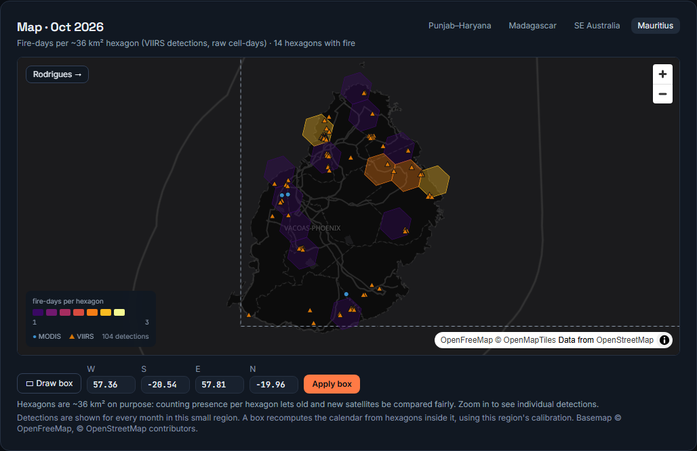

## 3. Proof `/proof`

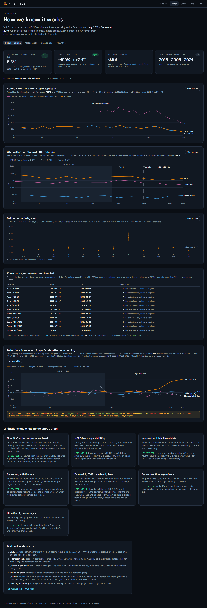

| # | On-screen label | Where | Do | Should happen | Why it exists | Verify it is real (file → key = current value) |
|---:|---|---|---|---|---|---|
| 1 | Region tabs | top | click each region | all cards and charts below switch region | navigation | — |
| 2 | OUT-OF-SAMPLE ANNUAL ERROR (V1) | card 1 | read per region | punjab 5.6% · madagascar 2.8% · se_australia 9.2% · mauritius 24.4%; ✓ pass / n/a | Best Use of Science: validated out of sample, honest limits | `validation_v1.json → regions.{id}.results.{method}.V1.mape_pct` |
| 3 | STEP AT 2012 (V3) | card 2 | read | punjab +199% → +3.1% · madagascar +294% → +2.9% · se_australia +168% → +9.2% · mauritius +405% → +11.1% | Best Use of Science: validated out of sample, honest limits; Challenge core: harmonize MODIS and VIIRS into one consistent record | `summary.step_raw_pct / step_harm_pct / step_modis_pct` |
| 4 | SEASONAL SHAPE (R) | card 3 | read | punjab 0.99 · madagascar 1.00 · se_australia 0.94 · mauritius 0.84 | Best Use of Science: validated out of sample, honest limits | `summary.shape_r` |
| 5 | Famous season / Biggest seasons (V9) | card 4 | read | SE Australia "#1" (Black Summer); Punjab "2016 · 2005 · 2021"; Madagascar "2016–17 · 2019–20" (3rd 2007–08) | Best Use of Science: validated out of sample, honest limits | `results.{method}.V9`; Terra-only seasons excluded |
| 6 | Before / after: the 2012 step disappears | chart | hover; View as table | dashed raw line jumps at 2012; harmonized (orange) tracks MODIS-only (blue) | Challenge core: harmonize MODIS and VIIRS into one consistent record | `regions/{id}.json → months[]` annual sums |
| 7 | Why calibration stops at 2019: orbit drift | chart | hover | calibration-window band 2012–2019; annotations "Terra drift", "Aqua drift", "MODIS 6.03 → 61.03" | Best Use of Science: validated out of sample, honest limits | `results.{method}.V4.drift` |
| 8 | Calibration ratio by month | chart | hover/table | one dot per month with 90% bar; dashed region-wide line; grey overlap counts | Best Use of Science: validated out of sample, honest limits | `regions/{id}.json → k.month/lo/hi/B` |
| 9 | Known outages detected and handled | table | read | e.g. Terra 2001-06-16 → 2001-07-03 (18 days); Aqua over Madagascar 2020-08-17 → 2020-09-02 on the Madagascar tab | Best Use of Science: validated out of sample, honest limits | `regions/{id}.json → quality.global_outages, regional_gaps` |
| 10 | Detection-time caveat: Punjab's late-afternoon burning | card + chart | read; View as table | "Aqua now sees ×1.5 … (×1.3 vs NOAA-20)"; Punjab Oct–Nov line climbs after the "Aqua drifts later" marker while the others stay near ×1.0; amber box with the caveat sentence | Best Use of Science: validated out of sample, honest limits (honest limitation) | `dataset/punjab_timing_v1.json → checks["punjab|Oct–Nov (rice residue)"].aqua_rel_2022_2026` = 1.461; `docs/punjab_timing.md` |
| 11 | Limitations and what we do about them | 7 cards | read | each card has a MITIGATION line | Best Use of Science: validated out of sample, honest limits | METHODS.md §10 |
| 12 | Full method (METHODS.md) → | last card | click | opens METHODS.md on GitHub | Best Use of Science: validated out of sample, honest limits | — |

## 4. Data `/data`

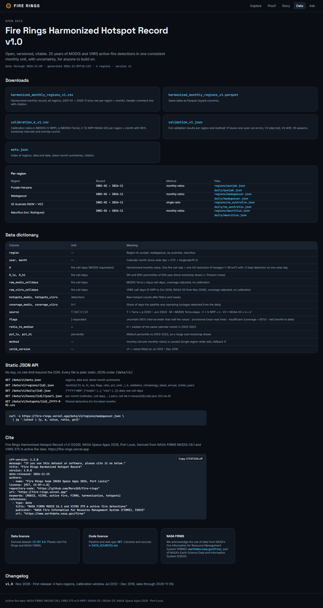

| # | On-screen label | Where | Do | Should happen | Why it exists | Verify it is real (file → key = current value) |
|---:|---|---|---|---|---|---|
| 1 | Fire Rings Harmonized Hotspot Record v1.0 | title | read | "Data through 2026-11-09" | Best Use of Data: open, versioned, citable dataset | `meta.json → data_end` |
| 2 | Downloads (5 cards) | section | click each | CSV/Parquet/JSON files download; CSVs begin with a "# …citation" line | Best Use of Data: open, versioned, citable dataset; Challenge: export CSV; Best Use of Data (give data back) | `dataset/*` |
| 3 | Per region table | section | click regions/{id}.json | JSON opens | Best Use of Data: open, versioned, citable dataset | `regions/*.json` |
| 4 | Data dictionary | section | read | one row per column with unit and meaning | Best Use of Data: open, versioned, citable dataset | — |
| 5 | Static JSON API + curl example | section | copy the curl into a terminal | returns latest-month JSON | Best Use of Data: open, versioned, citable dataset | `regions/madagascar.json → latest` |
| 6 | Copy CITATION.cff | button | click | citation copied; button says "Copied" | Best Use of Data: open, versioned, citable dataset | `CITATION.cff` |
| 7 | Licences / NASA FIRMS acknowledgement | cards | read | MIT code, CC BY 4.0 data, FIRMS text | Space Apps rules | — |

## 5. Ask `/ask`

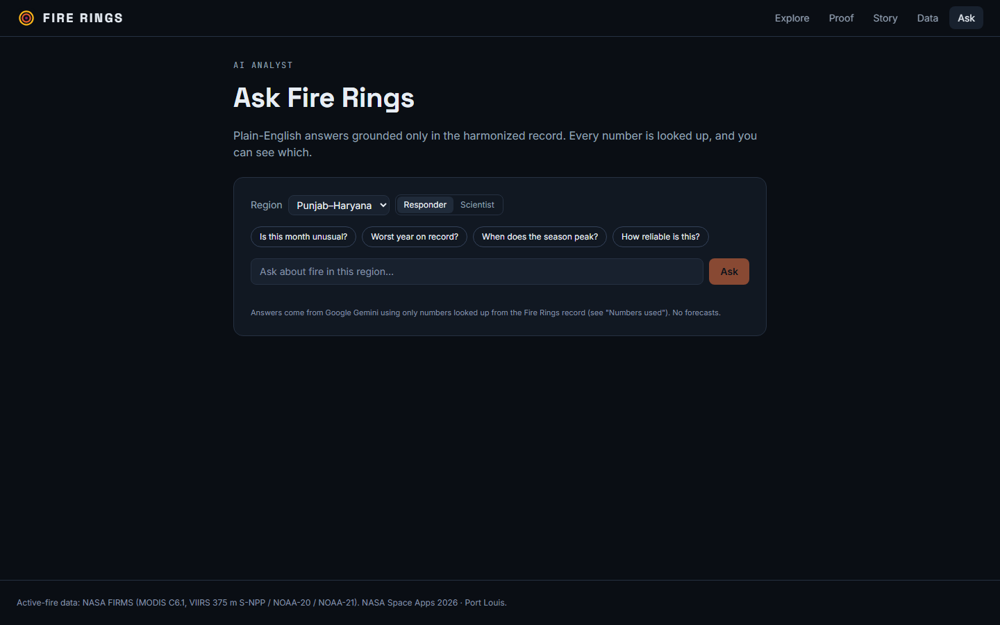

| # | On-screen label | Where | Do | Should happen | Why it exists | Verify it is real (file → key = current value) |
|---:|---|---|---|---|---|---|
| 1 | Region select / Responder · Scientist | top of panel | switch | later answers use that region/voice | Best Use of Data (accessible): plain-English answers grounded in the data | — |
| 2 | 4 chips | panel | click "Is this month unusual?" | answer card within ~25 s, or a saved answer with the amber "Live AI unavailable" note, or "AI temporarily unavailable" — never an endless spinner | Best Use of Data (accessible): plain-English answers grounded in the data | `ask_cache.json` (16/16 saved answers) |
| 3 | Numbers used (N lookups) | under each answer | click | lists every tool call and the values it returned; every number in the answer appears there | Best Use of Data (accessible): plain-English answers grounded in the data | server check in `web/api/_lib/core.ts`; `docs/ask_eval.md` (30/30, 0 unverified) |
| 4 | Free-text box + Ask | panel | ask "How many fires next month?" | declines to forecast | Best Use of Data (accessible): plain-English answers grounded in the data | — |

## 6. Story `/story/madagascar`

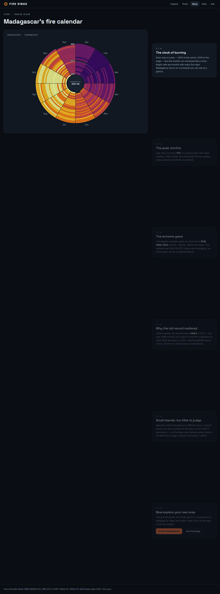

| # | On-screen label | Where | Do | Should happen | Why it exists | Verify it is real (file → key = current value) |
|---:|---|---|---|---|---|---|
| 1 | 1/6 … 6/6 steps | right column | scroll slowly | rings on the left stay pinned and change: peak months highlighted (step 2), top years (3), RAW view (4), Mauritius rings (5), buttons (6) | Local Impact: Indian Ocean / Madagascar / Mauritius | step texts computed from `regions/madagascar.json` (top years `annual[]` rankable only: 2016, 2005, 2013) |
| 2 | Explore Madagascar / Ask Fire Rings | step 6 | click | opens the region / the AI page | Local Impact: Indian Ocean / Madagascar / Mauritius | — |

## 7. 404

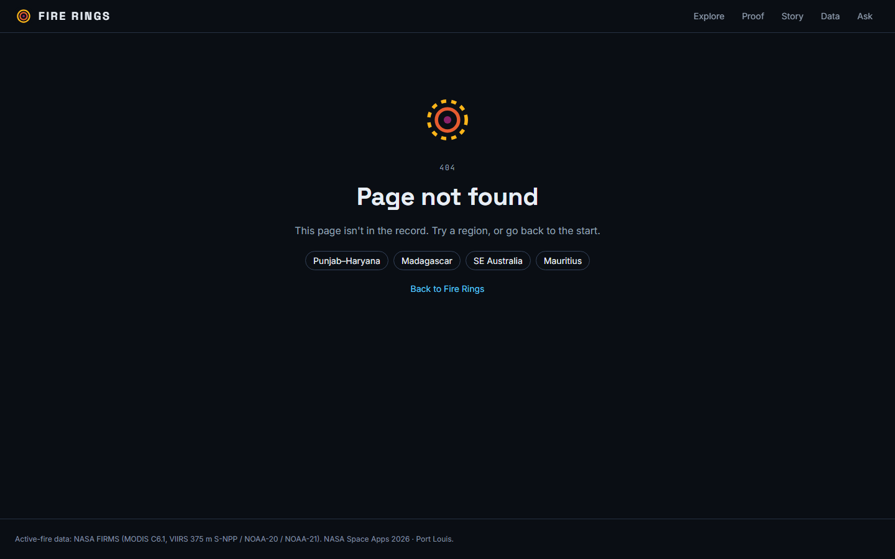

| # | On-screen label | Where | Do | Should happen | Why it exists | Verify it is real (file → key = current value) |
|---:|---|---|---|---|---|---|
| 1 | Page not found / Back to Fire Rings | centre | open /does-not-exist, click link | friendly message; link returns home | robustness | — |
| 2 | Region not found | centre | open /r/nowhere | lists the 4 available regions as links | robustness | — |

## 8. Phone (390 px) spot checks

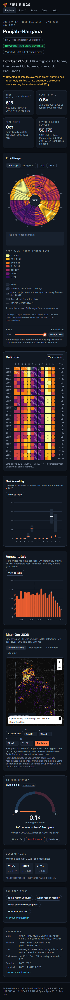

| # | On-screen label | Where | Do | Should happen | Why it exists | Verify it is real (file → key = current value) |
|---:|---|---|---|---|---|---|
| 1 | Whole page | all pages | scroll | no sideways scrolling; cards stack: headline → KPIs → rings → seam → grid → charts → map → insights | Quality bar (master plan §10): accessible to keyboard and screen-reader users | `web/scripts/overflow.mjs` (all routes 360 px) |
| 2 | Rings readout | under the rings | tap a cell | readout panel shows the month (no clipped tooltip) | Quality bar (master plan §10): accessible to keyboard and screen-reader users | — |
